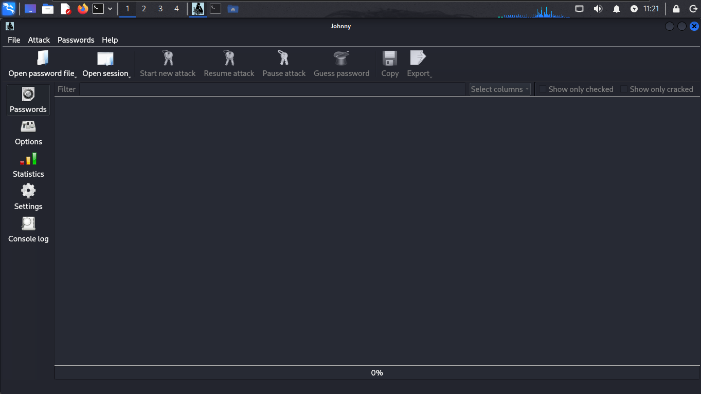
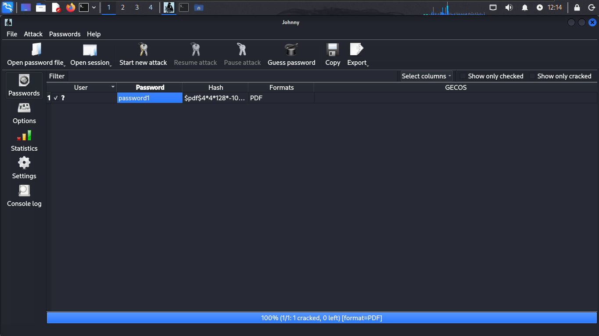
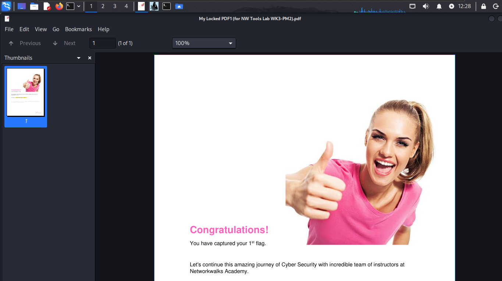
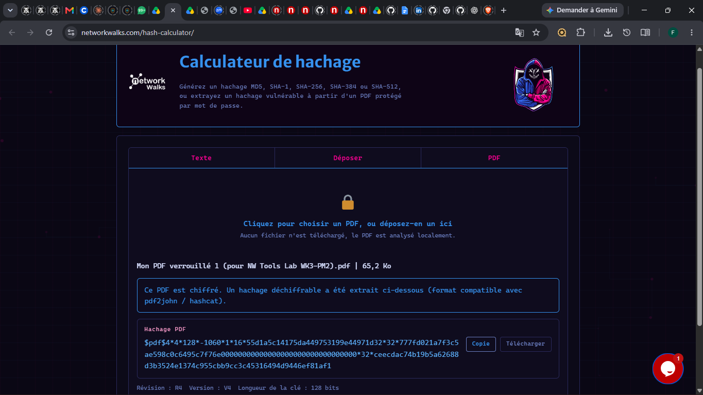
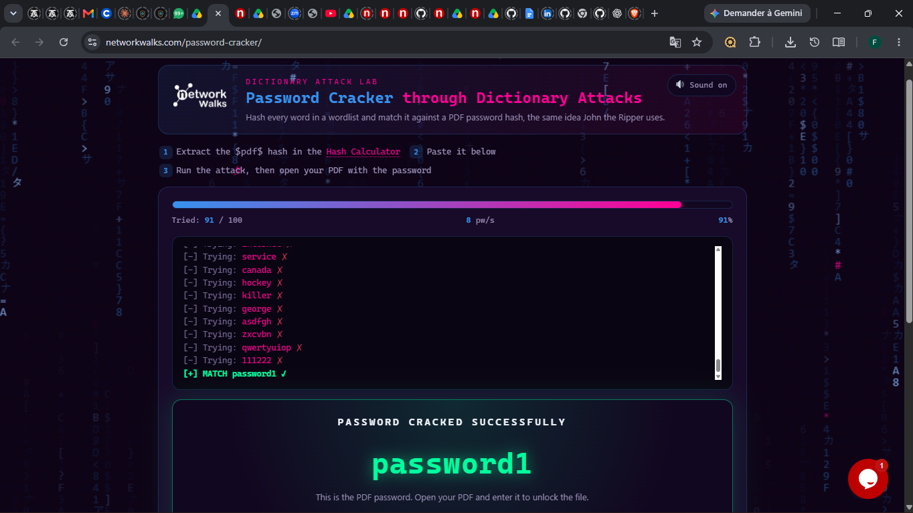

# 🔐Week-3-Password-Cracking-John-the-Ripper-and-Network-Tools

**Hands-on cybersecurity lab exploring PDF password recovery using John the Ripper (JTR), Johnny GUI, and Networkwalks Hash Calculator and Password Cracker. Covers PDF hash extraction, dictionary-based password attacks, and practical password security concepts**

---

## 📌 Project Overview

This project is part of my Week 3 Cybersecurity and Ethical Hacking practical training. It focuses on understanding password cracking techniques and recovering passwords from password-protected PDF files using two different approaches.

The project consists of two practical modules:

**Module 1: Password Cracking with John the Ripper (JTR)**

This module explores the use of John the Ripper and its graphical interface, Johnny GUI, to recover a password from an encrypted PDF file. The process involves extracting the PDF hash, saving it in a text file, loading it into Johnny, and performing a password-cracking attack.

**Module 2: Password Cracking with Networkwalks Tools**

This module demonstrates password recovery using Networkwalks' online Hash Calculator and Password Cracker. The process involves uploading a protected PDF to extract its hash, copying the hash into the Password Cracker, and running a dictionary-based attack to identify the password.

Through these practical exercises, the project explores PDF hash extraction, password-cracking techniques, dictionary attacks, and the importance of strong password protection.

The exercises were performed in a controlled learning environment for cybersecurity education and ethical hacking practice.
---

---

## 🎯 Objectives

The main objectives of this project are to:

1.Understand the fundamentals of password cracking and password recovery.

2.Learn how to use John the Ripper (JTR) and Johnny GUI for password-cracking exercises.

3.Understand how to extract password hashes from password-protected PDF files.

4.Gain practical experience using the Networkwalks Hash Calculator to extract PDF hashes.

5.Learn how to use the Networkwalks Password Cracker to perform dictionary-based password attacks.

6.Understand the process of identifying and recovering weak PDF passwords through controlled security testing.

7.Compare desktop-based and browser-based password-cracking tools.

8.Understand the importance of strong passwords and effective password security practices.

9.Develop practical cybersecurity and ethical hacking skills through hands-on laboratory exercises.

---

#Screenshots

## 💡 What I Learned

Through these practical cybersecurity exercises, I gained a better understanding of password cracking techniques, PDF hash extraction, and password security.

Key lessons include:

1. **John the Ripper (JTR):** Learned about John the Ripper and how its Johnny graphical interface can be used to perform password-cracking operations.

2. **PDF Hash Extraction:** Learned how to extract password hashes from protected PDF files and prepare them for password recovery.

3. **Hash File Preparation:** Understood how to save an extracted PDF hash into a text file and load it into John the Ripper.

4. **Networkwalks Hash Calculator:** Learned how to use the online Hash Calculator to extract PDF password hashes.

5. **Dictionary Attacks:** Gained an understanding of how dictionary-based attacks test different password combinations against an extracted hash to identify a match.

6. **Password Recovery:** Learned the process of recovering a PDF password using both desktop-based and browser-based tools.

7. **Hashing vs. Encryption:** Improved my understanding of the difference between hashing and encryption, including their roles in information security.

8. **Password Security:** Understood why short, common, and weak passwords are vulnerable to cracking attempts and why strong passwords are important.

9. **Practical Cybersecurity Skills:** Developed a better understanding of password security testing and the responsible use of password-cracking tools in ethical hacking exercises.

These exercises strengthened my foundational knowledge of password security, hash extraction, and practical cybersecurity testing.
---

# 👤 Author

**Farid BAYILI**\

## 📌 Project Information

**Program Name:** Cybersecurity at Networkwalks | **Week:** 03 | **Project:** Password-Cracking-Projects | **Repository:** GitHub
